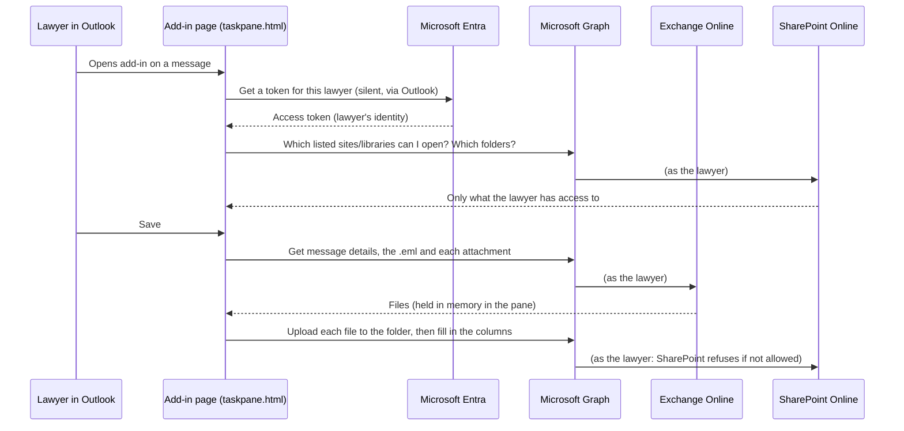
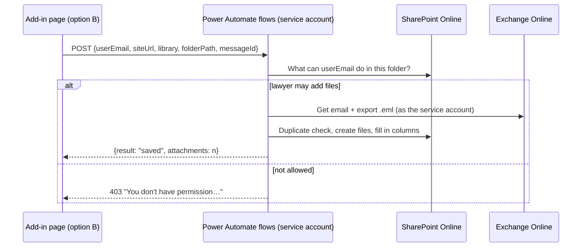

# Save to SharePoint — Outlook add-in for filing emails

An Outlook add-in that lets lawyers file the email they're reading into a SharePoint matter folder in a few clicks:

1. **Pick a site** (from a fixed list of up to ~20 sites; each lawyer only sees the sites they have access to).
2. **Pick or create a matter folder** in that site's document library (only folders they have access to are shown).
3. **Save.** The email is saved as an `.eml` file and **each attachment is saved as its own file** next to it, so SharePoint search can find text inside PDFs and Word documents. Every file gets the email's **Subject, From, To, Cc** and **message ID** in library columns.

Also included: a **duplicate check** (the same email is never filed twice), **up to 5 favourites per lawyer** (sites or folders, stored in their own mailbox), and clear messages when someone lacks permission.

This repository contains **two implementations of the same add-in**. They look and behave the same for the lawyer; they differ in how the work is done behind the scenes.

| | **Option C — sign-in + Microsoft Graph** ✅ recommended | **Option B — Power Automate** (alternative) |
|---|---|---|
| Who does the work | The add-in itself, **as the signed-in lawyer** | Four Power Automate flows, **as one service account** |
| Who enforces permissions | **SharePoint**, natively | The flows, by asking SharePoint about the lawyer's email address sent by the add-in |
| Security strength | Strong: the add-in can only do what the lawyer could do in SharePoint | Moderate: flow URLs are in the public page and the lawyer's identity is self-reported |
| Works for every lawyer's mailbox | Yes | Only mailboxes the flow account can open |
| "Created by" on saved files | The lawyer | The flow account |
| Admin setup | One app registration in Microsoft Entra + admin consent | Import 4 flows; flow account must be **site owner** on every site |
| Outlook versions | Outlook on the web; Windows Version 2409+; Mac 16.89+; recent iOS/Android | Any Outlook that supports add-ins (requirement set Mailbox 1.3) |
| Ongoing cost | None beyond existing licences | Flow runs count against the flow owner's Power Platform request limits |
| Files | `taskpane.html`, `lib/`, `manifest.xml` | `option-b-power-automate/`, `manifest.xml` (page address changed) |
| Detailed guide | [`docs/option-c-graph.md`](docs/option-c-graph.md) | [`docs/option-b-power-automate.md`](docs/option-b-power-automate.md) |

Deploy **one** of them. Use option B only if you can't register an app in Entra or users are on older Outlook versions.

---

## Contents

- [How it works](#how-it-works)
- [Repository layout](#repository-layout)
- [What each file contains](#what-each-file-contains)
- [Prerequisites](#prerequisites)
- [Deployment checklist](#deployment-checklist)
- [1. Hosting](#1-hosting)
- [2. SharePoint setup](#2-sharepoint-setup)
- [3. Deploy option C](#3-deploy-option-c-recommended)
- [4. Deploy option B](#4-deploy-option-b-alternative)
- [5. Deploy the manifest](#5-deploy-the-manifest)
- [Configuration reference](#configuration-reference)
- [Data, storage and security](#data-storage-and-security)
- [Testing with different users](#testing-with-different-users)
- [Troubleshooting](#troubleshooting)
- [Known limitations](#known-limitations)
- [Version history](#version-history)
- [Third-party notices](#third-party-notices)

---

## How it works

### The pieces

- **Manifest (`manifest.xml`)** — tells Outlook "there is an add-in called *Save to SharePoint*; put a button on the ribbon when a message is open; when clicked, open this web page in a side pane". It's uploaded once by an admin in the Microsoft 365 admin centre.
- **Task pane page (`taskpane.html`)** — the web page shown in the side pane. It's a single HTML file (no build step) hosted on any HTTPS site; this repo uses **GitHub Pages**. GitHub only *serves the code*; **no email content goes to GitHub**.
- **Microsoft 365** — Exchange Online (the mailbox), SharePoint Online (the libraries) and, for option C, Microsoft Entra (sign-in) and Microsoft Graph (the API).

### Option C — what happens when a lawyer clicks Save



The email goes **Exchange Online → the add-in in the lawyer's Outlook (memory only) → SharePoint Online**, entirely over Microsoft 365 HTTPS endpoints. There is no server of ours in between.

### Option B — what happens when a lawyer clicks Save



### Shared behaviour (both options)

- **File names:** `2026-10-29 1405 - RE Settlement offer.eml`, `2026-10-29 1405 - [1] Deed of Settlement.pdf`, … The prefix is the email's received date/time in Sydney time, so an email and its attachments sort together and same-subject emails never clash. Characters SharePoint rejects (`" * : < > ? / \ |`) are removed; subjects are cut to 100 characters.
- **Attachments:** every real file attachment is saved separately. Skipped on purpose: inline images (signature logos, pasted screenshots) and attached Outlook items (those stay inside the `.eml`).
- **Duplicate check:** before saving, the library is searched for the email's `InternetMessageId`. If found anywhere in the library, nothing new is saved and the lawyer sees *"Already filed"*.
- **Columns:** every saved file gets `InternetMessageId`, `EmailSubject`, `EmailFrom`, `EmailTo`, `EmailCc`. If a column is missing, the files are still saved and the lawyer sees which column to add.
- **Favourites:** up to 5 sites or folders per lawyer, added with ☆ and removed with × (or by clicking ★ again). Stored in the lawyer's own mailbox (Office *roaming settings*), so they follow the lawyer across Outlook on the web, Windows and Mac.

---

## Repository layout

```
/
├── README.md                         ← this file
├── manifest.xml                      ← Outlook add-in manifest (both options; v1.4.0.0)
├── taskpane.html                     ← OPTION C add-in page (recommended)
├── icon.png                          ← add-in icon (ribbon button + add-in list)
├── lib/
│   ├── msal-browser-5.25.1.min.js    ← Microsoft sign-in library (MSAL), used by option C
│   └── msal-browser-LICENSE.txt      ← its MIT licence
├── option-b-power-automate/
│   ├── taskpane.html                 ← OPTION B add-in page (calls the flows)
│   └── flows/                        ← Power Automate export packages (import into your environment)
│       ├── Check site access v3.zip
│       ├── Get Folders v3.zip
│       ├── Create new folder v3.zip
│       └── Get email v3.zip
└── docs/
    ├── option-c-graph.md             ← step-by-step deployment guide, option C
    └── option-b-power-automate.md    ← step-by-step deployment guide, option B (+ manual flow build)
```

Older files you may find in the repo history (`arash_*.zip`, `Outlook to Sharepoint Addin V1.zip`, `UPGRADE-GUIDE.md`, `OPTION-C-GUIDE.md`) are superseded by the above.

---

## What each file contains

### `manifest.xml` — the Outlook add-in manifest (XML, add-in-only manifest format)

| Element | Value | Meaning |
|---|---|---|
| `<Id>` | `fefd903a-…` | Unique ID of the add-in. **Keep it** when updating; use a **new GUID** for a separate deployment. |
| `<Version>` | `1.4.0.0` | Must go **up** every time a changed manifest is uploaded, or the admin centre rejects it. |
| `<DisplayName>`, `<Description>`, `<ProviderName>` | "Save to SharePoint", … | What admins and users see in the add-in list. |
| `<IconUrl>`, `<HighResolutionIconUrl>` | `…/icon.png` | Icon in the add-in list / admin centre. |
| `<SupportUrl>` | the hosting address | Link shown in the add-in details. |
| `<Requirements>` | `Mailbox 1.3` | Minimum Outlook API level (the page uses `item.itemId` and `convertToRestId`). |
| `<FormSettings>/<SourceLocation>` | `…/taskpane.html?v=c2` | Page opened in the pane. `?v=c2` is a cache-buster ([Versioning and caching](#versioning-and-caching)). |
| `<Permissions>` | `ReadWriteItem` | Lets the page read the open message and use roaming settings (favourites). |
| `<Rule>` | Message, Read | The add-in only appears when **reading** a message (not composing). |
| `<VersionOverrides>` | ribbon button | Adds a **Save to SharePoint** button to the *Message read* ribbon (group "Correspondence Archive") that opens the task pane. |
| `<Resources>` | icons, page URLs, labels | `icon-16/32/80` → `icon.png`; `Taskpane.Url`/`Commands.Url` → the page; button label and tooltip. |

Hosting address appears **9 times**; if you host elsewhere, replace `https://arash-afk.github.io/Microsoft-Outlook-addin` in all of them. For **option B**, change the **3** `taskpane.html` addresses to `…/option-b-power-automate/taskpane.html`.

### `taskpane.html` — option C page (HTML + CSS + JavaScript in one file)

No build tools, frameworks or external services apart from Office.js (Microsoft's CDN) and the bundled MSAL file. Sections, top to bottom:

1. **`<head>`** — loads `office.js` from Microsoft; all styles inline (light theme matching Outlook).
2. **Markup** — email summary, Favourites list, step 1 *Site* (dropdown + ☆), step 2 *Folder* (search box, folder list, create link, selected folder + ☆), Save button, status line, *Advanced* (message ID, *Refresh my site access*, *Signed in as*).
3. **Configuration block** (the only part you normally edit) — `CLIENT_ID`, `TENANT_ID`, `SITES`, `MAX_FAVOURITES`, `SITE_ACCESS_CACHE_HOURS`, `FILE_TIME_ZONE`. See [Configuration reference](#configuration-reference).
4. **Start-up** — reads the open message (subject, sender, message ID via `convertToRestId`), loads favourites, checks the Outlook supports nested sign-in (`NestedAppAuth 1.1`), creates the MSAL client with `createNestablePublicClientApplication`, gets a token silently (pop-up only if needed).
5. **`graph()` helper** — calls `https://graph.microsoft.com/v1.0` with the lawyer's token; retries politely on throttling (429/503); `graphBatch()` sends up to 20 requests in one round trip.
6. **Site access** — resolves each `SITES` entry with `GET /sites/{host}:{path}` and its library with `GET /sites/{id}/drives` (batched). Sites returning 403/404 or without the named library are hidden. The result is cached in the browser for 12 hours.
7. **Folders** — `GET /drives/{id}/root/children` (only folders the lawyer can see come back); create with `POST …/children` (fails cleanly if it exists).
8. **Save** — `GET /me/messages/{id}` (details) → duplicate check (`GET /sites/{id}/lists/{id}/items?$filter=fields/InternetMessageId eq '…'`) → `GET /me/messages/{id}/$value` (the `.eml`) → upload (simple `PUT` up to 4 MB, otherwise an **upload session** in 3.75 MB chunks) → `PATCH …/listItem/fields` (columns) → each attachment: `GET …/attachments/{id}/$value` → upload → columns.
9. **Favourites** — read/write `Office.context.roamingSettings` key `favourites`; max 5; add/remove; greyed "no access" entries can still be removed.
10. **Helpers** — status messages, last-used site memory, HTML escaping.

Microsoft Graph permissions used (delegated): `User.Read`, `Mail.Read`, `Sites.ReadWrite.All`.

### `lib/msal-browser-5.25.1.min.js` — Microsoft Authentication Library

Microsoft's official `@azure/msal-browser` **v5.25.1** browser bundle (released 2026-10-13), unmodified, taken from npm. It's served from the same site as the page rather than a third-party CDN. SHA-256: `56a548eae945c2479adf61d969140999e9f602ff627694cc0692346890556f52`. To upgrade: download a newer `lib/msal-browser.min.js` from the npm package, add it to `lib/`, and change the `<script src>` in `taskpane.html`.

### `icon.png`

60×60 PNG used for the ribbon button and the add-in list. Replace with your own square PNG (ideally 80×80 or larger) and re-upload the manifest with a higher version if the address changes.

### `option-b-power-automate/taskpane.html` — option B page

Same UI and features as option C. Differences: no sign-in; the configuration block holds four **flow URLs** (`CHECK_SITE_URL`, `LIST_FOLDERS_URL`, `CREATE_FOLDER_URL`, `SAVE_FLOW_URL`, shipped as `PASTE-…` placeholders); each action is a `POST` to a flow with `userEmail` (from Outlook's user profile), site, library and folder. Site access is checked by calling *Check site access* once per site in parallel.

### `option-b-power-automate/flows/*.zip` — Power Automate packages (legacy import format)

| Flow | Trigger input (JSON) | What it does | Returns |
|---|---|---|---|
| **Check site access** | `userEmail, siteUrl, library` | Validates the request; `ensureuser` (email → SharePoint login); reads the user's effective permissions on the library | `{ allowed: true/false }` |
| **Get Folders** | `userEmail, siteUrl, library` | Lists top-level folders; folders inheriting permissions are shown if the user can view the library; folders with their own permissions are checked one by one | `[{ Name, Path }]` |
| **Create new folder** | `userEmail, siteUrl, library, folderName` | Checks the user may add items to the library; creates the folder | `{ Name, Path }` or `403` |
| **Get email** | `messageId, mailboxAddress, userEmail, siteUrl, library, folderPath` | Checks the user may add to the folder; gets and exports the email; duplicate check; saves `.eml` + attachments; fills in the columns | `{ result: saved/duplicate, attachments, warning }` or `403` |

All four use the trigger **When a HTTP request is received** (anyone with the URL can call it) and the SharePoint **Send an HTTP request** action so one flow works for any site. A first step `Allowed_site_prefix` restricts them to your tenant's sites.

### `docs/option-c-graph.md` and `docs/option-b-power-automate.md`

Step-by-step deployment, test and troubleshooting guides for each option. Option B's guide also includes a manual build of the flows (part F) if package import fails.

---

## Prerequisites

| Need | Option C | Option B |
|---|---|---|
| Microsoft 365 with Exchange Online and SharePoint Online | ✔ | ✔ |
| An HTTPS web host for the page (GitHub Pages is fine) | ✔ | ✔ |
| Admin to deploy the add-in (Microsoft 365 admin centre → Integrated apps) | Global admin or Exchange admin | same |
| Admin to register an app and grant consent in Microsoft Entra | Global admin, or Application admin + Privileged Role admin | — |
| Power Automate in the tenant; a service account with a Power Automate licence | — | ✔ |
| Service account as **site owner** of every listed site | — | ✔ |
| Users' Outlook version | Web; Windows 2409+; Mac 16.89+ | any recent |
| Each user licensed for Exchange + SharePoint | ✔ | ✔ |

---

## Deployment checklist

1. **Host** the files ([1](#1-hosting)).
2. **Prepare SharePoint** libraries and columns ([2](#2-sharepoint-setup)).
3. Configure **either** option C ([3](#3-deploy-option-c-recommended)) **or** option B ([4](#4-deploy-option-b-alternative)).
4. **Deploy the manifest** ([5](#5-deploy-the-manifest)).
5. **Test** with at least two users ([Testing](#testing-with-different-users)).

---

## 1. Hosting

The add-in page must be served over **HTTPS** from a real domain. Outlook can't load it from a local file.

**GitHub Pages (as used here):**
1. Push the repository contents to the `main` branch (keep the folder structure).
2. Repo **Settings → Pages → Source: Deploy from a branch → `main` / `(root)` → Save**.
3. The site is published at `https://<github-user>.github.io/<repo-name>/` — here `https://arash-afk.github.io/Microsoft-Outlook-addin/`. Each push republishes in 1–2 minutes (the **Actions** tab shows progress).
4. Check in a browser: `…/taskpane.html` shows the pane (outside Outlook it stays on *"Loading email…"*, which is expected), and `…/icon.png` shows the icon.

GitHub Pages sites are **public**. That's fine for option C (the page holds no secrets; `CLIENT_ID`/`TENANT_ID` are identifiers). For option B, the flow URLs in the page act like keys; see [security](#data-storage-and-security).

**Another host** (Azure Static Web Apps, an internal web server, etc.): publish the same files with the same folder structure, then replace the hosting address in `manifest.xml` (9 places) and, for option C, use the new domain in the Entra redirect URI (`brk-multihub://<your domain>`).

---

## 2. SharePoint setup

Do this for **every site** you'll list in `SITES` (both options).

### 2.1 Pick the library and note its URL name

1. Open the site → open the document library emails should be filed into.
2. The part of the address after the site URL is the library's **URL name**:
   - `https://contoso.sharepoint.com/sites/Litigation/Client%20Correspondence/Forms/AllItems.aspx` → `Client Correspondence`
   - The default **Documents** library is usually `Shared Documents` (not "Documents").
3. Note for each site: **display name** (what lawyers see), **site URL**, **library URL name**.

Matters are **top-level folders** in that library. Lawyers pick an existing one or create a new one from the add-in.

### 2.2 Add the five columns

Create these in **every** listed library. The **name typed when creating** the column must match exactly (no spaces); it becomes the column's internal name, which is what the add-in writes to.

| Create with this name | Type | Filled with |
|---|---|---|
| `InternetMessageId` | Single line of text | The email's unique ID (duplicate check — **required**) |
| `EmailSubject` | Single line of text | Subject |
| `EmailFrom` | Single line of text | Sender's address |
| `EmailTo` | **Multiple lines of text** (plain text) | To addresses, separated by `;` |
| `EmailCc` | **Multiple lines of text** (plain text) | Cc addresses, separated by `;` |

1. Library → **+ Add column** → type from the table → **Next** → name exactly as in the table → **Save**.
2. For `EmailTo` / `EmailCc`, under **More options** turn off "Use enhanced rich text".
3. Optional: rename the display names afterwards (e.g. `EmailSubject` → "Subject"). Rename **after** creating, never before; the internal name doesn't change.
4. Optional: **+ Add column → Show/hide columns** to arrange the view; you may hide `InternetMessageId`.

### 2.3 Index `InternetMessageId`

Library → ⚙️ **Settings → Library settings → More library settings → Indexed columns → Create a new index** → primary column `InternetMessageId` → **Create**. Without it, the duplicate check fails once the library passes 5,000 items.

### 2.4 Permissions (recommended model)

Both options respect SharePoint permissions, so set them up in SharePoint, not in the add-in:

- Grant access **at site level using groups**: one Microsoft 365 or security group per site / practice area. Edit (Members) = can file; Read (Visitors) = can see but not file.
- Give individual matter folders **their own permissions** only for genuine ethical walls (folder **⋯ → Manage access → Advanced settings → Stop Inheriting Permissions**).
- For a very sensitive client, prefer a separate library or site over a locked-down folder.

| What the lawyer sees / can do | Needs |
|---|---|
| A site appears in step 1 | Access to that site's library (Read or more; option B also counts "Limited access" from folder-only permissions) |
| A folder appears in step 2 | Read on that folder |
| Create a folder | Edit/Contribute on the library |
| Save an email | Edit/Contribute on the folder |

---

## 3. Deploy option C (recommended)

Full steps: [`docs/option-c-graph.md`](docs/option-c-graph.md). Summary:

1. **Microsoft Entra → App registrations → New registration**
   - Name `Save to SharePoint add-in`; **single tenant**.
   - Redirect URI: platform **Single-page application (SPA)**, value `brk-multihub://<hosting domain>`, e.g. `brk-multihub://arash-afk.github.io` (domain only, no path).
2. **API permissions → Microsoft Graph → Delegated:** `User.Read`, `Mail.Read`, `Sites.ReadWrite.All` → **Grant admin consent**. No client secret is needed.
3. If Conditional Access uses the retired **"Require approved client app"** grant, switch it to **"Require app protection policy"**.
4. In `taskpane.html`, set `CLIENT_ID` (Application (client) ID) and `TENANT_ID` (Directory (tenant) ID), and the `SITES` list.
5. Publish `taskpane.html`, `lib/`, `icon.png` to the host.
6. Deploy `manifest.xml` ([5](#5-deploy-the-manifest)).

## 4. Deploy option B (alternative)

Full steps: [`docs/option-b-power-automate.md`](docs/option-b-power-automate.md). Summary:

1. Choose a **service account** with a Power Automate licence; make it **site owner** on every listed site.
2. Import the four packages from `option-b-power-automate/flows/` (Power Automate → **My flows → Import → Import Package (Legacy)**, *Create as new*), mapping the SharePoint (and Office 365 Outlook) connections to the service account.
3. In each flow, set **Allowed_site_prefix** to your tenant (e.g. `https://contoso.sharepoint.com/sites/`) and turn it **On**.
4. Copy each flow's HTTP URL into `option-b-power-automate/taskpane.html` (`CHECK_SITE_URL`, `LIST_FOLDERS_URL`, `CREATE_FOLDER_URL`, `SAVE_FLOW_URL`) and set `SITES`.
5. Publish `option-b-power-automate/taskpane.html` and `icon.png`.
6. In `manifest.xml`, change the 3 `taskpane.html` addresses to `…/option-b-power-automate/taskpane.html?v=b1`, then deploy it ([5](#5-deploy-the-manifest)).

---

## 5. Deploy the manifest

**Centrally, for the organisation (recommended):**
1. Microsoft 365 admin centre → **Settings → Integrated apps → Upload custom apps**.
2. App type **Office Add-in** → **Upload manifest file (.xml) from device** → `manifest.xml`.
3. Assign to **Entire organisation**, or to specific users/groups (e.g. a pilot group) → **Deploy**.
4. It can take **up to 24 hours** to appear in everyone's Outlook (often a few hours; Outlook on the web is usually first).

**To update an existing deployment:** Integrated apps → *Save to SharePoint* → **Update add-in** → upload the new `manifest.xml`. The `<Id>` must be the same and the `<Version>` **higher** than the deployed one; otherwise you get *"Please update the version number in the manifest file"*.

**For a single person (testing):** <https://aka.ms/olksideload> → **My add-ins → Custom add-ins → Add a custom add-in → Add from file** (if user sideloading is allowed in the tenant).

**Using the button:** open a **single message** (not a conversation header with several messages selected; Outlook greys out add-in buttons then) → **Save to SharePoint** on the ribbon (or under **Apps** / **⋯**).

### Versioning and caching

Outlook keeps its own copy of add-in pages, so a newly published `taskpane.html` may not show up immediately. Rules of thumb:

- **Small page changes** (e.g. editing `SITES`): just publish. Users get it after restarting Outlook / signing in again, or when Outlook refreshes its cache.
- **Big page changes** (switching between options, new features): change the cache-buster in the 3 `taskpane.html` addresses in the manifest (`?v=c2` → `?v=c3`), raise `<Version>`, and **Update add-in** in Integrated apps. Outlook then fetches the page from a new address.
- **Clear a stubborn cache:** Outlook on the web — sign out/in or use a private window; classic Outlook for Windows — close it and delete the contents of `%LOCALAPPDATA%\Microsoft\Office\16.0\Wef\`; new Outlook / Mac — quit fully and restart, or sign out/in.
- How to tell which page is running: option C shows *"Signing you in…"* and **Advanced → "Signed in as …"**; option B shows *"Checking your access…"* and no "Signed in as".

---

## Configuration reference

All settings are constants near the top of the page's `<script>`.

| Setting | Option | Default | Meaning |
|---|---|---|---|
| `CLIENT_ID` | C | — | Application (client) ID of the Entra app registration. Identifier, not a secret. |
| `TENANT_ID` | C | — | Directory (tenant) ID. Identifier, not a secret. |
| `CHECK_SITE_URL`, `LIST_FOLDERS_URL`, `CREATE_FOLDER_URL`, `SAVE_FLOW_URL` | B | `PASTE-…` | HTTP URLs of the four flows. Treat as keys. |
| `SITES` | both | Neota, Site 02 | `{ name, siteUrl, library }` per site. `name`: shown to lawyers (sorted A–Z). `siteUrl`: full site address, no trailing `/`. `library`: library **URL name** (section 2.1). Lawyers only see the sites they can access. |
| `MAX_FAVOURITES` | both | 5 | Favourites per lawyer. |
| `SITE_ACCESS_CACHE_HOURS` | both | 12 | How long each computer remembers which sites a lawyer can open (**Advanced → Refresh my site access** clears it). Folder lists, new folders and saves are always live. |
| `FILE_TIME_ZONE` | C | `Australia/Sydney` | Time zone for the date prefix in file names. (Option B: set in the *Get email* flow, step `File_name_prefix`.) |
| `SCOPES` | C | `User.Read`, `Mail.Read`, `Sites.ReadWrite.All` | Graph permissions requested; must match the app registration. |

Example `SITES`:

```js
const SITES = [
  { name: "Litigation", siteUrl: "https://contoso.sharepoint.com/sites/Litigation", library: "Client Correspondence" },
  { name: "Property",   siteUrl: "https://contoso.sharepoint.com/sites/Property",   library: "Shared Documents" },
];
```

---

## Data, storage and security

### Option C

- **Where data goes:** Exchange Online → the add-in pane in the lawyer's Outlook (memory only) → SharePoint Online, via `graph.microsoft.com`. Nothing is sent to GitHub or any other service.
- **Who acts:** the signed-in lawyer, with **delegated** permissions: the add-in can't reach any mailbox, site or folder the lawyer couldn't open themselves. Admin consent is granted once for the organisation.
- **Secrets:** none in the page. `CLIENT_ID` and `TENANT_ID` are public identifiers; tokens are issued per user at run time.
- **Stored on the device:** MSAL's token cache and the site-access cache (browser storage of the add-in's origin); the last site used.
- **Stored in the mailbox:** the lawyer's favourites (Office roaming settings, private to them and to this add-in).
- **Audit:** files show the lawyer as **Created by**; SharePoint and Entra sign-in logs record the activity under the lawyer.

### Option B

- The four flow URLs work for **anyone who has them** (trigger authentication "Anyone"), and they are in the public page.
- The page **tells** the flows who the user is (`userEmail`); a technical person could call a flow claiming to be someone else. The flows still only allow sites under `Allowed_site_prefix` and only do what that claimed user may do.
- The flows run as the **service account**, which must own every site, and read emails with **its** Outlook connection (so only mailboxes it can open).
- Use option B as an interim or fallback; prefer option C for production.

---

## Testing with different users

A small test setup covers everything:

| | **Test Alice** (Litigation) | **Test Bob** (Property) |
|---|---|---|
| Group | `SP Litigation Lawyers` | `SP Property Lawyers` |
| Site 1 (e.g. Neota) | **Edit**: sees it, can file | **Read**: sees it, can't file or create folders |
| Site 2 (e.g. Test Property) | **No access**: not in her list | **Edit**: sees it, can file |
| "Walled Matter" folder in site 1 (own permissions, owners only) | Hidden | Hidden |

1. **Licences:** each test user needs a licence with Exchange + SharePoint (e.g. Business Basic/Standard, or a trial). Without a mailbox they can't run the add-in.
2. **Users:** admin centre → **Users → Active users → Add a user** (assign the licence).
3. **Groups:** admin centre → **Teams & groups → Security groups → Add a security group**; add the members.
4. **Site access:** each site → ⚙️ **Site permissions → Share site only** (or **Advanced permissions settings**) → add the group as Edit or Read. Allow up to an hour for group changes to reach SharePoint.
5. **Ethical wall:** create "Walled Matter", stop inheriting permissions, leave only Owners.
6. **Add-in:** make sure the deployment includes the test users (or let them sideload it).
7. **Test side by side** in two private browser windows at <https://outlook.office.com>, one per user. Send both an email with a PDF and a Cc. Check the table row by row; after a permission change use **Advanced → Refresh my site access**. In SharePoint, check **Created by** and the five columns.
8. **Clean up:** delete test users (frees licences), groups and test sites.

---

## Troubleshooting

| Symptom | Likely cause / fix |
|---|---|
| No **Save to SharePoint** button | Add-in not deployed to this user yet (allow up to 24 h), or you're composing rather than reading a message. |
| Button greyed out | A conversation with several messages is selected; click a single message. |
| Pane shows old behaviour / old page | Outlook's cached copy. See [Versioning and caching](#versioning-and-caching). |
| *Sign-in isn't set up* (C) | `CLIENT_ID` / `TENANT_ID` still `PASTE-…`. |
| *…hasn't been approved for your organisation yet* (C) | Admin consent not granted. |
| *…sign-in address in the app registration doesn't match* (C) | SPA redirect URI must be exactly `brk-multihub://<hosting domain>`. |
| *…sign-in policy blocked it* / *You can't get there from here* (C) | Conditional Access: replace "Require approved client app". |
| *Please update Outlook* (C) | Outlook older than Windows 2409 / Mac 16.89. Use Outlook on the web, update, or deploy option B. |
| Blank pane (C) | `lib/` not published. |
| *The add-in isn't set up…* (B) | A flow URL is still `PASTE-…`. |
| *Couldn't check your access to N site(s)* | B: service account isn't site owner, or a `SITES` entry is wrong. C: usually a typo in `siteUrl`. |
| A site is missing for someone | They lack access to that site's library, or `library` doesn't match the URL name. Then **Refresh my site access**. |
| *You don't have permission…* | Working as intended (read-only or no access there). |
| *…some columns weren't filled in (EmailCc)* | That column is missing in this library (section 2.2). |
| Duplicate check stops working on a large library | `InternetMessageId` not indexed (2.3). |
| A scanned PDF isn't found by search | It has no text layer; SharePoint can only search text in the PDF. |
| *Upload failed* when uploading the manifest | `<Version>` not higher than the deployed one, or the icon/page addresses aren't reachable yet. |

More in each option's guide under `docs/`.

---

## Known limitations

- **Shared / delegated mailboxes:** saving from a shared mailbox isn't supported (option C would need `Mail.Read.Shared` and a small code change).
- **Duplicate check visibility:** it only finds earlier copies the lawyer can see (option C) / the service account can see (option B).
- **Folder depth:** step 2 lists the library's **top-level** folders (matters). Sub-folders aren't browsed.
- **Option B:** see its security notes above; folders with their own permissions are checked one by one (≈0.5 s each), so libraries with 50+ such folders list slowly; flow runs count against Power Platform limits.
- **Option C:** requires the Outlook versions above.

---

## Version history

| Version | Changes |
|---|---|
| 1.0 | Single library, folder picker, save `.eml` via Power Automate, duplicate check. |
| 1.1 | Site → Folder (list of sites); attachments saved as separate files. |
| 1.2 | Subject / From / To / Cc columns; manifest fixes for central deployment. |
| v3 (option B) | Per-user permission checks in the flows (new *Check site access* flow); favourites (max 5). |
| **Option C (manifest 1.4.0.0)** | Lawyer signs in (MSAL nested app authentication); everything via Microsoft Graph as the lawyer; no Power Automate; works for every mailbox; chunked uploads for large files; manifest cache-buster `?v=c2`. |

---

## Third-party notices

- `lib/msal-browser-5.25.1.min.js` — Microsoft Authentication Library for JavaScript (`@azure/msal-browser`), © Microsoft Corporation, MIT licence (`lib/msal-browser-LICENSE.txt`).
- Office.js is loaded from Microsoft's CDN (`appsforoffice.microsoft.com`) under Microsoft's terms.
